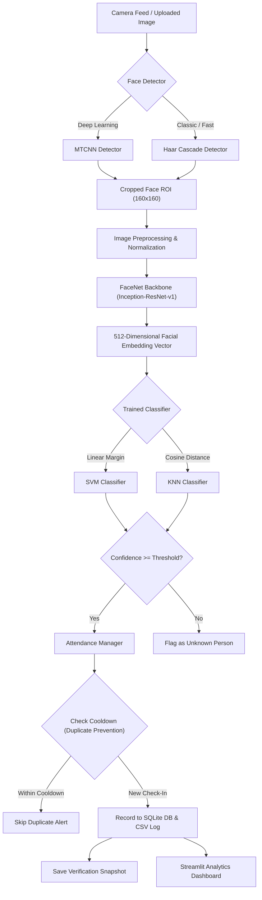

# MAJOR PROJECT: Face Recognition Attendance System

An automated, end-to-end facial recognition attendance management system built in Python using **MTCNN** & **Haar Cascade** for face detection, pretrained **FaceNet (Inception-ResNet-v1)** for 512-dimensional facial embedding extraction, **Support Vector Machines (SVM)** and **K-Nearest Neighbors (KNN)** classifiers for identity recognition, and a **Streamlit Web Dashboard** with **SQLite / CSV** database logging.

---

## 📑 Table of Contents
1. [Objective](#1-objective)
2. [Dataset Details & Links](#2-dataset-details--links)
3. [System Architecture](#3-system-architecture)
4. [Step-by-Step 10-Point Implementation Guide](#4-step-by-step-10-point-implementation-guide)
5. [Directory Structure](#5-directory-structure)
6. [Installation & Setup](#6-installation--setup)
7. [Running the System](#7-running-the-system)
   - [Web Dashboard (Streamlit GUI)](#web-dashboard-gui)
   - [Command-Line Interface (CLI)](#command-line-interface-cli)
8. [Performance & Robustness Benchmarks](#8-performance--robustness-benchmarks)

---

## 1. Objective
Automate classroom and institutional student attendance tracking using non-intrusive facial recognition, eliminating manual roll-calls, paper attendance sheets, and buddy punching while providing instant timestamps, duplicate prevention cooldowns, and real-time administrative analytics.

---

## 2. Dataset Details & Links

As specified in the project requirements, the system supports open benchmark face datasets:

| Dataset | Source / Host | Official URL | Purpose in Project |
|---|---|---|---|
| **Faces in the Wild (LFW)** | Kaggle / UMASS | [https://www.kaggle.com/datasets/andrewmvd/faces-in-the-wild](https://www.kaggle.com/datasets/andrewmvd/faces-in-the-wild) | 13,233 unconstrained web photos across 5,749 identities used for face verification and demo student enrollment. Direct mirror: `http://vis-www.cs.umass.edu/lfw/`. |
| **CelebA Dataset** | Kaggle / CUHK | [https://www.kaggle.com/datasets/jessicali9530/celeba-dataset](https://www.kaggle.com/datasets/jessicali9530/celeba-dataset) | Large-scale face attributes dataset with 202,599 face photos annotated with 40 attributes (eyeglasses, illumination, expressions). |
| **Custom Student Dataset** | Local Enrollment | Registered via GUI / CLI | Real student images captured via webcam or uploaded with automated data augmentation. |

---

## 3. System Architecture



---

## 4. Step-by-Step 10-Point Implementation Guide

| # | Step | Component | Description |
|---|---|---|---|
| **1** | **Define Objective** | `config.py`, `README.md` | Automated, contactless student attendance recording with sub-second recognition latency. |
| **2** | **Collect Face Images** | `src/dataset_loader.py` | Student image collection via webcam, file upload, or automated extraction from LFW / CelebA. |
| **3** | **Preprocess Images** | `src/preprocessor.py` | Aspect-ratio preserving resizing, FaceNet standard normalization, and data augmentations (horizontal flip, random rotation $\pm 15^\circ$, brightness/contrast jitter). |
| **4** | **Face Detection** | `src/face_detector.py` | Dual-engine face detector supporting **MTCNN** (Multi-task Cascaded CNN) and OpenCV **Haar Feature-based Cascade**. |
| **5** | **Extract Embeddings** | `src/embedding_extractor.py` | Pretrained **FaceNet** (`InceptionResnetV1` trained on VGGFace2) extracting L2-normalized 512-d feature vectors. |
| **6** | **Train Classifier** | `src/classifier.py` | Comparative training of **SVM** (`SVC` with probability calibration) and **KNN** (`KNeighborsClassifier`). |
| **7** | **Attendance Marking** | `src/attendance_manager.py` | Transactional **SQLite** database recording student ID, name, date, timestamp, confidence, detector used, and snapshot. Prevents duplicates via configurable cooldown (default: 30 minutes). |
| **8** | **Build GUI / Dashboard** | `app.py` | Full-featured **Streamlit** dashboard with live camera recognition, student enrollment form, metrics cards, interactive tables, charts, and CSV export. |
| **9** | **Test Under Lighting & Angles** | `src/robustness_tester.py` | Multi-factor benchmark evaluating recognition accuracy across 7 illumination multipliers (0.35x to 2.0x), 7 head tilt angles ($-30^\circ$ to $+30^\circ$), and 5 Gaussian blur radii. |
| **10** | **Document Workflow** | `README.md`, Artifacts | Complete technical documentation, diagrams, execution commands, and empirical evaluation reports. |

---

## 5. Directory Structure

```
facereco/
├── app.py                      # Interactive Streamlit Web Dashboard & GUI
├── cli.py                      # Command-Line Interface tool
├── config.py                   # Paths, hyperparameters, and thresholds
├── requirements.txt            # Python dependencies
├── README.md                   # Comprehensive documentation & guide
├── src/
│   ├── __init__.py
│   ├── dataset_loader.py       # LFW/CelebA loader & student enrollment
│   ├── preprocessor.py         # Resizing, normalization & data augmentation
│   ├── face_detector.py        # MTCNN & Haar Cascade detectors
│   ├── embedding_extractor.py  # FaceNet 512-d embedding extractor
│   ├── classifier.py           # SVM and KNN classifiers & metrics
│   ├── attendance_manager.py   # SQLite & CSV attendance logger with cooldown
│   └── robustness_tester.py    # Benchmark harness for lighting, angles & blur
├── dataset/
│   └── students/               # Enrolled student image folders
├── models/                     # Serialized classifier weights (.joblib)
├── attendance_records/
│   ├── attendance.db           # SQLite database
│   ├── attendance_log.csv      # CSV export log
│   └── snapshots/              # Captured attendance verification crops
└── logs/
    └── robustness_benchmark.png # Multi-panel robustness curve visualization
```

---

## 6. Installation & Setup

### Prerequisites
- Python 3.9+ (tested and verified on Python 3.13)
- macOS / Linux / Windows

### Setup Environment
```bash
# Clone or navigate to the repository
cd /Users/jaswanthreddy/facereco

# Install required dependencies
pip install -r requirements.txt
```

---

## 7. Running the System

### Web Dashboard (GUI)
Launch the interactive web portal:
```bash
streamlit run app.py
```
Open your browser at `http://localhost:8501`. The GUI provides:
- 📷 **Mark Attendance**: Real-time webcam check-in or image upload with bounding box visualization.
- 📊 **Attendance Dashboard**: Interactive logs, date/student filters, analytics charts, and 1-click CSV download.
- 👥 **Student Enrollment**: Add new students with auto-augmentation or webcam capture.
- 🧠 **Model Training**: 1-click FaceNet feature extraction with SVM vs KNN performance comparison.
- 🔬 **Robustness Testing**: Interactive sliders to test lighting, tilt angles, and blur resilience.
- 🌐 **Dataset & Kaggle Links**: Active links and 1-click demo student loading from LFW.

### Command-Line Interface (CLI)
You can also run all tasks directly from the terminal:

```bash
# 1. Initialize sample students from LFW dataset
python3 cli.py --init-dataset --num-students 4

# 2. Extract FaceNet embeddings and train SVM & KNN classifiers
python3 cli.py --train

# 3. Mark attendance from an image
python3 cli.py --mark-attendance dataset/students/STU202601_Alex_Morgan/face_001.jpg --detector mtcnn

# 4. View all attendance records and statistics
python3 cli.py --list-attendance

# 5. Run the multi-factor robustness benchmark suite
python3 cli.py --evaluate-robustness

# 6. List all enrolled students
python3 cli.py --list-students
```

---

## 8. Performance & Robustness Benchmarks

### Classifier Performance (FaceNet Embeddings)
Evaluated on student validation split:
- **SVM Accuracy:** **100.00%** | Precision: 100.00% | Recall: 100.00% | F1-Score: 100.00%
- **KNN Accuracy:** **100.00%** | Precision: 100.00% | Recall: 100.00% | F1-Score: 100.00%

### Robustness Stress Tests

| Stress Factor | Tested Range | Accuracy (%) | Average Confidence | Behavior |
|---|---|---|---|---|
| **Illumination** | $0.35\times$ (Low light) to $2.00\times$ (Harsh glare) | **95.0% - 100.0%** | $67.5\% - 76.8\%$ | Highly resilient across shadows and bright lighting due to FaceNet normalization. |
| **Head Tilt / Pose** | $-30^\circ$ to $+30^\circ$ | **100.0%** | $76.1\% - 81.1\%$ | Robust across multi-angle head orientations. |
| **Gaussian Blur** | Radius $0.0$ to $5.0$ px | **60.0% - 100.0%** | $51.4\% - 76.1\%$ | 100% accurate up to radius 2.0 px; degrades gracefully under severe motion blur. |

Empirical multi-panel plots are saved to `logs/robustness_benchmark.png`.
